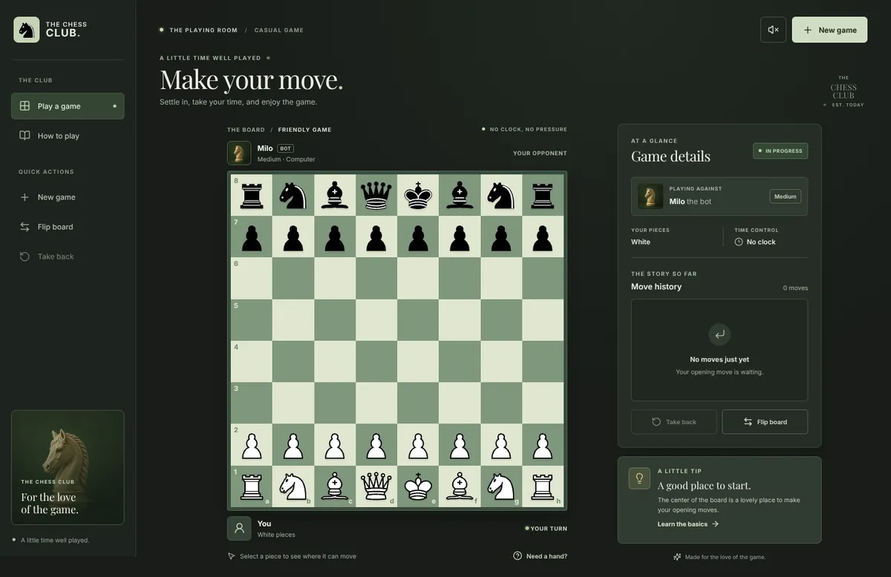

<div align="center">
  
  <h1>The Chess Club</h1>
  <p><strong>A little time well played.</strong></p>
  <p>A thoughtful game of chess, ready whenever you are.</p>
  <p>
    <a href="https://shogun-support-99.github.io/chess/"><strong>▶ Play chess in your browser</strong></a>
    &nbsp; · &nbsp;
    <a href="#getting-started">Run it locally</a>
    &nbsp; · &nbsp;
    <a href="#how-to-play">How to play</a>
  </p>
  <p>
    <a href="https://github.com/shogun-support-99/chess/actions/workflows/deploy.yml"></a>
  </p>
</div>

<a href="https://shogun-support-99.github.io/chess/"></a>

## Your board, your pace

Play a relaxed game against **Milo**, a computer opponent that runs entirely in your browser. There is no account, download, or clock—just you, the board, and your next move.

**[Open the chess game →](https://shogun-support-99.github.io/chess/)**

| Made for a good game | Made for your screen |
| --- | --- |
| Three computer difficulty levels | Responsive desktop and mobile layout |
| Play as white or black | Click, tap, drag, or use the keyboard |
| Legal moves and special rules | Undo, flip the board, and review moves |
| Checkmate and draw detection | Your game is saved locally in your browser |

Milo is a lightweight local opponent, not a tournament-strength chess engine. Chess rules are powered by [chess.js](https://github.com/jhlywa/chess.js).

## How to play

1. **Choose a piece.** Select it to see its legal destinations.
2. **Make your move.** Select a highlighted square, or drag the piece there.
3. **Take your time.** Milo responds after your move. Use **Take back** to undo your move and its reply, or **Flip board** to change your view.

For a new game, choose your side and difficulty with **New game**. Castling, en passant, promotion, checkmate, stalemate, repetition, and other draw rules are supported.

Using a keyboard? Tab to the board, navigate with the arrow keys, and press **Enter** or **Space** to select a square. The in-game guide explains how each piece moves.

## Getting started

You'll need Node.js **20.19+** or **22.12+**.

```bash
npm ci
npm run dev
```

Open the local URL printed by Vite. Other useful commands:

```bash
npm test                 # Run the chess-logic tests
npm run build            # Create a production build
npm run preview          # Preview the production build locally
```

### Project map

```text
src/App.jsx              Game screen and interaction state
src/components/          Board and accessible dialogs
src/chess.js             Rules helpers and computer opponent
src/engine.worker.js     Background computer-move calculation
public/                  Chess pieces and artwork
tests/                   Chess-logic regression tests
.github/workflows/       GitHub Pages deployment
```

The playable app starts at `src/main.jsx`. An earlier TypeScript site prototype and its plan are also preserved in the repository; they are not part of the current game build.

## Deployment

The [GitHub Pages workflow](.github/workflows/deploy.yml) installs dependencies, runs the tests, builds with the `/chess/` base path, and publishes the site when changes are merged to `main`. It can also be run manually from the Actions tab.

The live game is at **[shogun-support-99.github.io/chess](https://shogun-support-99.github.io/chess/)**. Your saved game and settings remain in your browser's local storage; clearing browser data removes them.

## Design & credits

- The interface was designed with [UI/UX Pro Max](https://github.com/nextlevelbuilder/ui-ux-pro-max-skill), installed at `.agents/skills/ui-ux-pro-max` from upstream revision `28b3b8dee8c976df4fa3e94aed4e092ad43fcb03`. The skill's MIT license is included in that directory.
- Chess pieces are the Cburnett set from [Lichess](https://github.com/lichess-org/lila/tree/master/public/piece/cburnett), originally by [Cburnett](https://commons.wikimedia.org/wiki/User:Cburnett) under [CC BY-SA 3.0](https://creativecommons.org/licenses/by-sa/3.0/). The SVGs are unmodified from the Lichess distribution.
- The knight illustration was generated for this project. Inter and Playfair Display are distributed through Fontsource under the SIL Open Font License.
